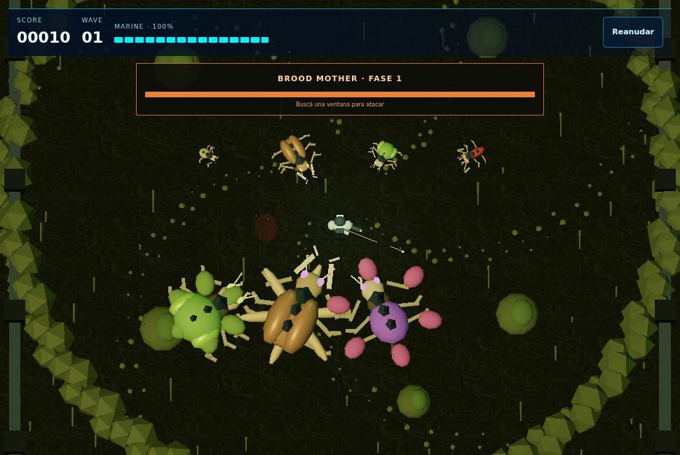
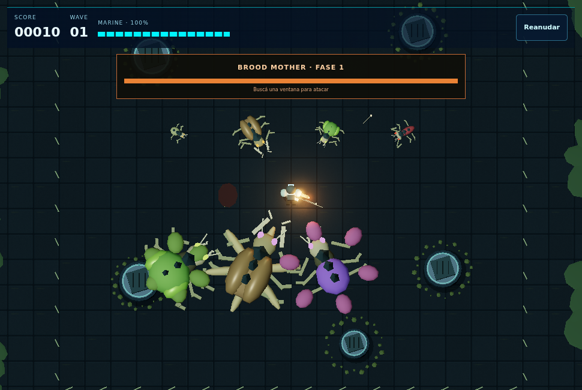

# Neon Arena V5 — entrega incremental

Base de aplicación: `5d4b401` (botón Nightmare compacto). El prompt `0429030` también se incorpora al parche para dejar la especificación junto al código.

## Auditoría y superficie

Se preservan Nightmare Protocolo, catálogo/portal existentes, IDs, progreso, récords individual/cooperativo, armas/jefes y audio de las otras experiencias. No hay dependencias npm nuevas ni backend. Continúa Three.js 0.186.1.

| Responsabilidad | Cambio |
|---|---|
| Presentación/lifecycle | Hook `useImmersiveArena` y CSS del juego; atributos temporales en el portal propio |
| Arena | `ArenaDefinition` inmutable compartida por simulación, cobertura, seguimiento y escena |
| Arte | `SurvivalWorld`: materiales PBR procedurales originales, instalaciones y contaminación |
| Diagnóstico | `RenderMetrics` y opción del menú; contadores por frame completo |
| Música | `ContainmentScore` + transporte existente de `brainBoostAudio`; cuatro stems originales |

## Funcionalidad

### Giro y fullscreen

En móvil, el juego activo se adapta al horizontal sin montar otro canvas. Los mínimos de altura no fuerzan scroll. El modo inmersivo usa el viewport completo; el nativo se confirma con `fullscreenElement`. Se intenta fullscreen desde un giro real compatible o desde el botón explícito. Rechazar la API conserva el fallback y permite reintentar con un toque.

Escape sale de inmersivo y pausa antes de que el listener general cierre el catálogo. Salida nativa, rechazo y petición pendiente se gestionan sin dejar una entrada tardía a fullscreen. El resize libera los punteros y reinicia el acumulador, conservando partida/renderer. La página recupera el scroll al salir. No se bloquea la orientación.

### Mapa

El juego real usa `DEFAULT_ARENA` / colony: límite lógico ±25 (50×50), suelo 57×57 y muros centrados en ±25.4, con cara interior alineada al límite lógico ±25. Los seis obstáculos compartidos mantienen corredores conocidos. Spawn de perímetro en radio 24 con búsqueda de posiciones seguras. No aumentan enemigos, daño, velocidad ni rango automáticamente.

El constructor de simulación mantiene el perfil legacy por compatibilidad; el engine selecciona explícitamente el predeterminado colony. Las pruebas comprueban ambos: no se usa la campaña antigua como sustituto de la nueva.

Piloto legítimo de la configuración nueva: solo movimiento, disparo, equipamiento y Shockwave. Con semilla 42819 y Asistido llega a oleada 16, tres jefes, cinco armas, 57 de salud y 519.02 segundos simulados. Reproduce el resultado y se verifica con los límites de 120 y 240 enemigos. El piloto manual antiguo aplicado sin ajustes al mapa nuevo murió en la oleada 12: no se afirma que cualquier política de control complete el juego. La campaña legacy manual aceptada sigue pasando.

### Arte y rendimiento

Suelo de placas, juntas, tornillos, marcas, arañazos, normales y rugosidad. Generadores de cobertura coincidentes con los círculos lógicos. Muros, costillas, tuberías, ventilación, luces y membranas de perímetro. Partículas de vapor limitadas y sombras de contacto simples. Geometría repetida instanciada y recursos registrados para dispose; composer opcional.

Calidad automática/baja/alta cambia resolución/postprocesado sin cambiar las reglas. Diagnóstico opcional: FPS, p95 de frame, CPU de actualización/render submission, llamadas, triángulos y recursos Three.js; en cooperativo cuenta ambas vistas. No son mediciones de tiempo GPU ni VRAM. Pausa y pestaña oculta no se acumulan como tiempo de gameplay.

### Banda sonora

`Containment Breach`: composición original creada con el script reproducible `tools/neon-arena/compose_containment.py`, sin samples de terceros. 128 BPM, re menor con dominante mayor, 4/4, cuatro stems de ocho compases / 15 segundos. Arreglo por capas con cuatro frases y variación de estado, en un ciclo de 60 segundos. Formatos Ogg Vorbis y MP3; solo se descarga el compatible al empezar a jugar.

Archivos y procedencia: `public/brain-boost/audio/containment/manifest.json`. Vista previa de un minuto: `preview.mp3`, no precargada por el juego. El script usa Python/numpy y ffmpeg únicamente para reproducir la producción; no hacen falta en Termux para instalar o ejecutar la versión entregada.

El transporte reutiliza contexto, buses, mute y un único scheduler de Brain Boost. Los stems empiezan en el mismo instante/fase y la mezcla cambia en fronteras de compás. Pausa detiene las fuentes y conserva fase; reanudar reutiliza los cuatro buffers. Salir/reiniciar cancela la carga propia y libera la caché. Se puede regular música aparte del mute global. Fallo de red/decodificación deja síntesis audible de respaldo, identificada en el menú.

La instrumentación de Chromium midió aproximadamente 12.62 MiB de PCM decodificado para las cuatro capas. La vista previa tiene volumen medio aproximado de -18.1 dBFS y pico de -2.7 dBFS según ffmpeg; esto no certifica calidad artística ni sustituye escucharla en el teléfono.

## Validación

- Línea base: 85/85 pruebas.
- Línea nueva: 92/92 en Node 24 y Node 26 x64; typecheck y build PASS. Sigue el aviso de chunks grandes.
- Escenario nuevo: campaña input-only y compatibilidad legacy PASS.
- Navegador: selección/Strict Mode, recuperación WebGL/salida, hermanos y Daily, disparo sostenido, cooperativo/rotación, fullscreen/rechazo/Escape, tres jefes/desbloqueos y criaturas: PASS.
- Ogg y MP3: cuatro stems reales, PCM decodificado, RMS positivo, un scheduler, pausa/reanudar/volumen/mute/salida y fallback con recursos bloqueados: PASS. Salir y volver a entrar vuelve a decodificar cuatro buffers, demostrando que la caché de la sesión anterior se liberó.

Las capturas comparables fueron inspeccionadas durante el desarrollo. Las pruebas instrumentadas usan Chromium/SwiftShader: no certifican 60 FPS, temperatura, fullscreen por giro físico ni comodidad en Android real.

## Límites y prueba del usuario

Pendiente en el dispositivo físico: rotación real con la UI del navegador, Back, ergonomía en horizontal, rendimiento sostenido durante 10–15 minutos y escucha en altavoz/auriculares. La composición se entrega como material original trabajado e integrado; su calidad musical final requiere evaluación de escucha del usuario. No hay certificación humana de mezcla profesional.

No se hizo push. Backups y datos previos se conservaron.

## Evidencia adicional

El stress lógico de 3600 pasos usó el mapa colony. Para mantener vivo el harness aplica invulnerabilidad explícita, exclusivamente en el benchmark; no es el piloto de aceptación. Con 120 enemigos iniciales se midió media 0.146ms / p95 0.44ms de step; con 240, media 0.674ms / p95 1.25ms en este host x64. Son tiempos CPU de simulación, no tiempos GPU, FPS Android ni una prueba térmica.

Las capturas adjuntas usan una galería controlada con las mismas especies y encuadre comparable. No representan una campaña real con siete jefes simultáneos. Sirven para revisar materiales y composición antes/después.

- `4f378c5`: viewport inmersivo y fullscreen.
- `40ff989`: arena compartida de 50×50 y campaña nueva.
- `a9b50d2`: colonia, materiales y diagnóstico.
- `ceb6cc6`: composición original y transporte por capas.

El cierre de QA también alinea los muros con el límite lógico, verifica el límite de 240 enemigos y adapta la prueba cooperativa para salir correctamente del fullscreen nativo antes de redimensionar la ventana de automatización.

La prueba nueva fuerza una reducción automática de resolución mientras se mantiene FUEGO y reproduce el fallo previo. Con la corrección, ratón y táctil conservan el disparo/retarget al reducir DPR; un giro real que cambia el tamaño sigue cancelando los punteros y pasa su prueba independiente.

### Capturas

Escena controlada de comparación, no campaña real:

Vista previa musical de 60 segundos: `public/brain-boost/audio/containment/preview.mp3`.
